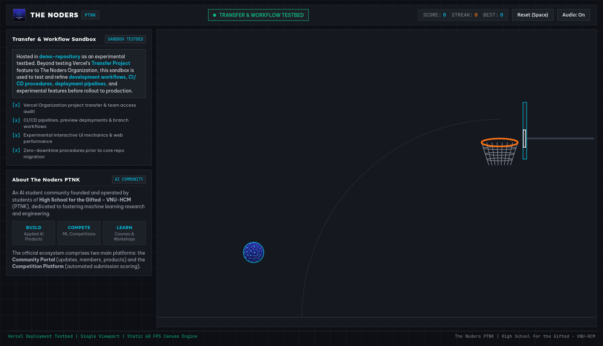

# The Noders PTNK - Vercel Transfer & Sandbox Workflow Testbed

> **Purpose:** This repository was created to test the **Transfer Project** feature on the **Vercel** platform to the official organization account (**The Noders**), prior to transferring the two official production repositories (`The-Noders-PTNK` and `The-Noders-Competition-Platform`).  
> 
> Additionally, this repository serves as an **independent testing environment (Staging / Sandbox)** to test and experiment with new features, development workflows, CI/CD pipelines, and collaboration rules before applying them to official systems.

## Testing Scope

1. **Vercel Transfer Project Verification:**
   - Test transferring projects from a personal account to Vercel Team / Organization.
   - Verify member role permissions after transfer (Owner, Admin, Member, Contributor).

2. **Development Workflow & Process Testing:**
   - Test Git workflows, Pull Request preview deployments, and staging branches.
   - Evaluate compatibility of DevOps and CI/CD tools.

---

## Running Instructions

Open the `index.html` file directly in a web browser.

---

*The Noders PTNK © 2026 — PTNK Artificial Intelligence Club*

---
---

# The Noders PTNK - Vercel Transfer & Sandbox Workflow Testbed

> **Mục đích:** Repository này được tạo ra để thử nghiệm tính năng **Transfer Project** trên nền tảng **Vercel** sang tài khoản tổ chức (Organization) chính thức của **The Noders**, trước khi tiến hành chuyển giao 2 repository sản phẩm chính thức (`The-Noders-PTNK` và `The-Noders-Competition-Platform`).  
> 
> Ngoài ra, repository này đóng vai trò như một **môi trường thử nghiệm độc lập (Staging / Sandbox)** để kiểm tra, thử nghiệm các tính năng mới, quy trình phát triển (development workflows), luồng triển khai CI/CD và quy tắc cộng tác trước khi áp dụng vào các hệ thống chính thức.

## Phạm vi Thử nghiệm (Testing Scope)

1. **Thẩm định quy trình Vercel Transfer Project:**
   - Kiểm tra di chuyển dự án từ tài khoản cá nhân sang Vercel Team / Organization.
   - Xác thực phân quyền thành viên sau khi chuyển giao (Owner, Admin, Member, Contributor).

2. **Thử nghiệm Quy trình & Workflow phát triển:**
   - Thử nghiệm các quy trình làm việc Git, Pull Request preview deployments và nhánh staging.
   - Đánh giá khả năng tương thích của các công cụ DevOps và CI/CD.

---

## Hướng dẫn Chạy

Mở trực tiếp file `index.html` bằng trình duyệt.

---

*The Noders PTNK © 2026 — Câu lạc bộ Trí tuệ Nhân tạo PTNK*
